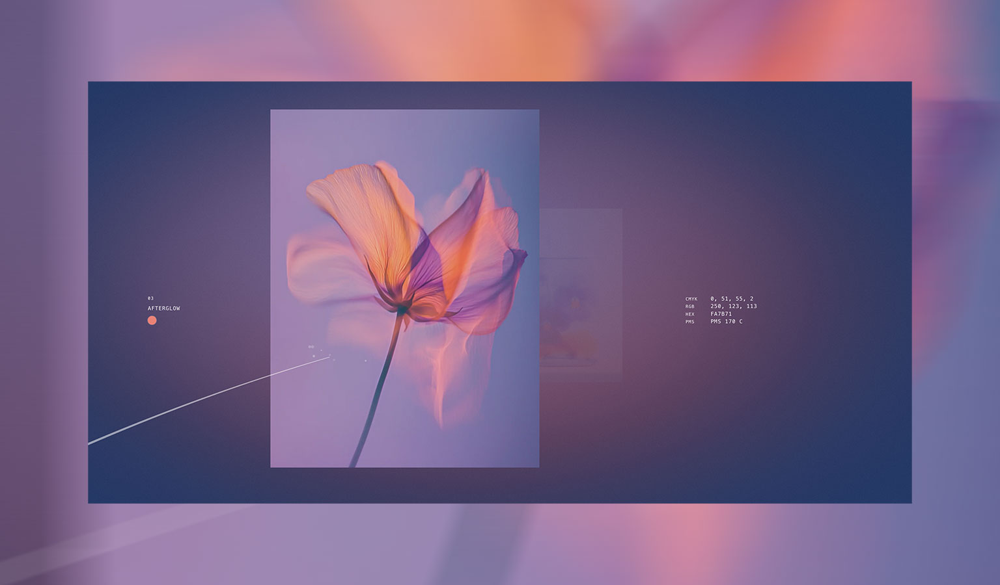

# Atmospheric Depth Gallery

A Three.js depth-scrolling image gallery where scroll velocity drives atmospheric mood and subtle motion, while each image defines its own background palette.



[Article on Codrops](https://tympanus.net/codrops/?p=111409)

[Demo](https://tympanus.net/Tutorials/DepthGallery/)

## Installation

```
npm install
npm run dev
```

For production build:

```
npm run build
npm run preview
```

## Tech Stack

- Node.js >= 18
- [Vite](https://vite.dev/)
- [Three.js](https://threejs.org/)
- Vanilla JavaScript (ES Modules)
- GLSL (via vite-plugin-glsl)

## Credits

- Built with [Three.js](https://threejs.org/)
- Imagery from [Lummi.ai](https://lummi.ai/)
- Color chip editorial layout inspired by [@thisislandscape](https://www.instagram.com/p/DU2JTU_AEwM/?img_index=3) on Instagram

## Misc

Follow Houmahani Kane: [Portfolio](https://houmahani.com), [X](https://x.com/houma_hani), [Instagram](https://www.instagram.com/houma.hani/), [LinkedIn](https://www.linkedin.com/in/houmahanikane/), [GitHub](https://github.com/houmahani/)

Follow Codrops: [X](http://www.x.com/codrops), [Facebook](https://www.facebook.com/codrops), [Instagram](https://www.instagram.com/codropsss/), [LinkedIn](https://www.linkedin.com/company/codrops/), [GitHub](https://github.com/codrops)

## License

[MIT](LICENSE)

## Reconstruction reference and verification

Source: Houmahani Kane on Codrops, MIT — https://github.com/houmahani/codrops-depth-gallery. The original Three.js scene, photography, shader, camera, label styling, and scroll mechanics are retained at `/`. Arrow keys, Page Up/Down, Home and End also explore the gallery. For reduced motion, the real scene renders still frames on demand; if WebGL is unavailable the gallery offers the source photographs with previous/next controls.

Comparison-only references (never loaded by the application):

- https://showcase.foxora.studio/prompts/codrops-depth-gallery/
- https://codrops-1f606.kxcdn.com/codrops/wp-content/uploads/2026/03/depthscroll_demo.mp4?x48895
- https://tympanus.net/codrops/hub/all/

```json
{
  "registryVersion": "7.4.0",
  "slug": "codrops-depth-gallery",
  "kind": "Motion",
  "source": "https://tympanus.net/Tutorials/DepthGallery/",
  "poster": "https://showcase.foxora.studio/thumbnails/curated-codrops-depth-gallery.webp",
  "motion": "https://showcase.foxora.studio/motion/codrops-depth-gallery.webp",
  "originalVisual": "https://codrops-1f606.kxcdn.com/codrops/wp-content/uploads/2026/03/depthscroll_featured-400x300.webp?x48895",
  "referenceOnly": true,
  "normalRootMayRenderReferenceMedia": false,
  "frame": {
    "width": 960,
    "height": 610,
    "aspectRatio": 1.5738
  }
}
```
